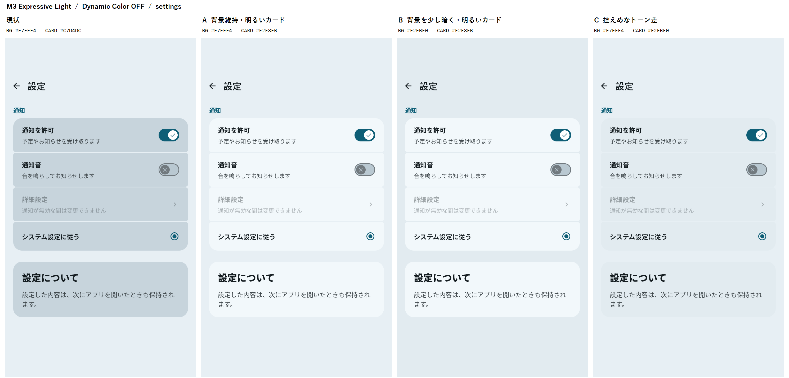
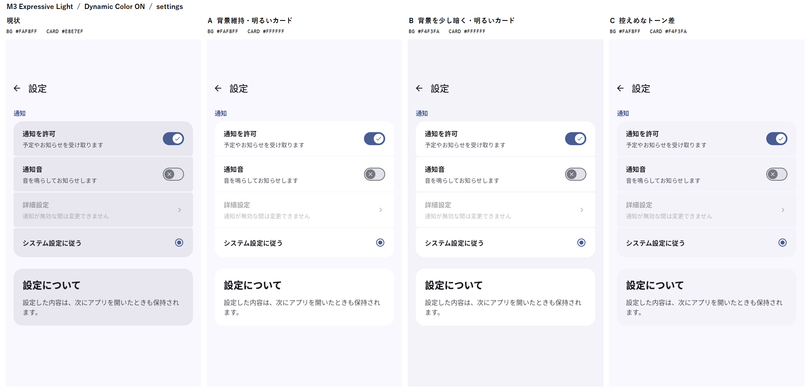
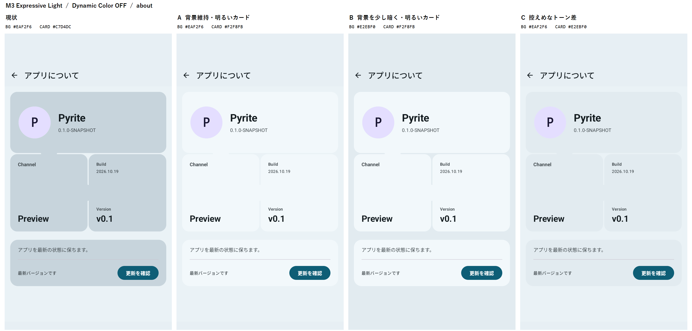
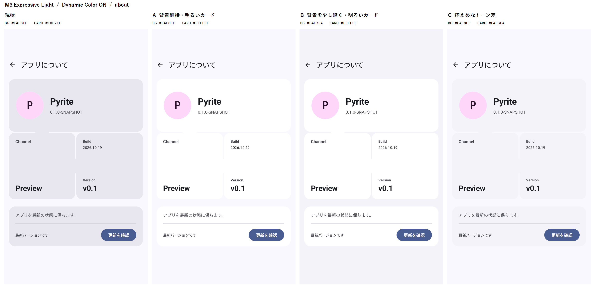

# M3 Expressiveライト配色比較 — B採用

2026-10-19。変更前と3候補をDynamic Color OFF/ONで比較した資料です。**比較提示後にユーザーがBを選択しました。** 以下の「現状」は比較時点の変更前を指します。製品への反映内容は[B採用記録](adoption.md)に記載します。

## 比較時点の実装

| 対象 | 元ファイル | 現行ロール |
| --- | --- | --- |
| OFFのライトパレット | `pyrite/src/main/kotlin/jp/linkserver/pyrite/theme/SourceColors.kt` | SourceExpressiveLight（Scheduler由来の独自定義） |
| Dynamic ON/OFF選択 | `pyrite/src/main/kotlin/jp/linkserver/pyrite/theme/PyriteTheme.kt` | API 31以上のONは公式dynamicLightColorScheme、OFFはSourceExpressiveLight |
| ヘッダー・設定ページ | `screen/PyriteScreenScaffold.kt`、`settings/SettingsScreen.kt` | surface |
| 設定行 | `settings/SettingsItems.kt` RowSurface | surfaceContainerHigh |
| 説明・アクションカード | `card/SettingsCards.kt` | surfaceContainerHigh |
| About本文・モザイクの隙間 | `about/AboutScreen.kt`、`about/AboutOverviewMosaic.kt` | background |
| Aboutモザイク・アクション・更新カード | `about/AboutOverviewMosaic.kt`、`about/AboutComponents.kt` | surfaceContainerHigh |

OFFでは設定背景が#E7EFF4、カードが#C7D4DCと大きく離れています。ONでは端末の公式パレットを使いますが、同じHighロールをカードへ割り当てるため、やはり背景よりカードが暗くなります。

[Google公式のカラーロール表](https://github.com/material-components/material-components-android/blob/master/docs/theming/Color.md#using-the-color-theming-system)では、ライトのsurfaceはneutral98、surfaceContainerLowはneutral96、Highはneutral92、Lowestは白です。Highは「最も明るい面」を意味しません。独自OFFパレットでは、現状カードの暗さが特に目立ちます。

## 比較候補

各候補は、**選択中の配色から既存のカラーロールを取得**します。新しい固定色、白の直書き、alpha混色、明度を数値で加工する処理は追加していません。ONでカードが#FFFFFFになるのは、その端末のsurfaceContainerLowestが返す値です。

| 案 | ページ背景 | 共通の中立カード | 見え方・トレードオフ |
| --- | --- | --- | --- |
| 現状 | 設定surface、About background | surfaceContainerHigh | 特にOFFで暗い大きな塊が強く見える |
| A | 現状維持 | surfaceContainerLowest | 全体が明るい。ONでは背景とカードが近く、平坦に見えやすい |
| B | ヘッダー・設定・AboutをsurfaceContainerLow | surfaceContainerLowest | 背景を少し暗くし、明るいカードを分離。Aboutの隙間と接続形状も見分けやすい |
| C | 現状維持 | surfaceContainerLow | 標準のSurface系トーン階層を控えめに使う。カードが少し暗い関係は残る |

**ユーザーが採用した案はB**です。「背景より明るいカード」という目的に合い、OFF/ON双方で分離が保たれます。Aは背景変更を避けたい場合、Cは従来の暗いコンテナ表現を薄く残したい場合の比較候補でした。Google設定アプリそのものとの同一性を保証する比較ではありません。

## 撮影条件と画面ごとの所見

API 35 Pixel_6a、720×1280px、density 240、通常文字サイズ。M3Eライト固定で、同じ日本語・同じ状態の設定/About構成を公開Pyriteコンポーネントから描画しました。OSステータスバーの文字等はComposeのキャプチャには含まれません。Dynamic ONは検証AVDの現在の壁紙/システム配色（青紫系）であり、すべての壁紙で同じ色になるわけではありません。

比較シートは左から**現状・A・B・C**。原寸の各スクリーンショットを縮小・再着色せず横に配置し、上部に比較用のラベルだけを付けています。ラベルはアプリUIには含まれません。個別PNGは`screenshots/`にあります。

### 1. 設定画面 — 配置・文字・操作状態は良好、面の明度を比較

ON/OFFのSwitch、無効な遷移行、選択済みRadio、説明カードを同じ状態で撮影しました。Bは明るいカードを維持しながら、画面背景との境界を確認しやすくなっています。AはONで白に近い面が続き、CはOFFで背景とのトーン差が特に小さくなります。

Dynamic OFF：

Dynamic ON：

### 2. About画面 — モザイク形状・情報配置は良好、接続の見やすさを比較

アプリアイコン・情報カード・Channel/Build/Versionモザイク・更新カードを比較しました。Bはヘッダーと本文の背景ロールも揃い、カードと隙間を追いやすくなります。Aは元のヘッダーsurface/本文backgroundを維持するため、OFFのわずかな背景差も残ります。Cは落ち着いた一方、モザイクの面と隙間が近い印象です。形状・寸法の変更はありません。

Dynamic OFF：

Dynamic ON：

## 実測色

| Dynamic | 案 | 設定背景 | About背景 | カード | カード本文/補足のコントラスト |
| --- | --- | --- | --- | --- | --- |
| OFF | 現状 | #E7EFF4 | #EAF2F6 | #C7D4DC | 11.41 / 6.17 |
| OFF | A | #E7EFF4 | #EAF2F6 | #F2F8FB | 16.11 / 8.71 |
| OFF | B | #E2EBF0 | #E2EBF0 | #F2F8FB | 16.11 / 8.71 |
| OFF | C | #E7EFF4 | #EAF2F6 | #E2EBF0 | 14.28 / 7.72 |
| ON | 現状 | #FAF8FF | #FAF8FF | #E8E7EF | 13.99 / 7.63 |
| ON | A | #FAF8FF | #FAF8FF | #FFFFFF | 17.18 / 9.37 |
| ON | B | #F4F3FA | #F4F3FA | #FFFFFF | 17.18 / 9.37 |
| ON | C | #FAF8FF | #FAF8FF | #F4F3FA | 15.58 / 8.50 |

比率は`(明るい方の相対輝度 + 0.05) / (暗い方 + 0.05)`。全候補で有効項目のonSurface/onSurfaceVariant対カードは4.5:1以上です。セクション見出しprimary対設定背景も全候補5.83:1以上。元の配色も通常文字の比率は確保されており、今回の主題は視覚的な面の階層です。無効文字のalpha・Switchの色ロールは変更していません。スクリーンショットとこれらの比率だけで、完全なアクセシビリティ適合やTalkBack品質を保証するものではありません。

生の値は[metrics.json](metrics.json)に保存しています。

## 比較作成時の検証と変更範囲

- 比較用`M3LightPaletteComparisonTest`のみ追加。製品側ソースは本件では変更していません。直前のスクロール修正等の未コミット成果は保持しています。
- 比較用APK/テストAPKビルド成功。公開済みローカルMaven AARを利用し、比較テスト1件成功（8配色条件・設定/About計16枚、25.779秒）。
- 有効な本文・補足文字の色対比、primary/onSurface/onSurfaceVariant/未選択Switch用surfaceContainerHighestが不変、viewportが不変、Switch操作でcallbackが1回であることを確認しました。
- 撮影用に既存コンポーネントのHigh参照先をTheme内で投影しています。**これは比較限定の処理**です。採用時にColorSchemeのHighの意味を全体的に変えるAPIや、アプリごとの自由なカスタマイズAPIを追加する方針ではありません。
- 比較提示時点では製品変更は未実施でした。B決定後にM3Eライトだけの内部ロール割当として反映しました。Nothing/ダークへの反映は行いません。[採用後の検証](adoption.md)を参照してください。
- 多数の壁紙・OSコントラスト設定・他メーカー実機の比較は未実施です。今回、既存全件UIテスト・AAR再発行は不要として繰り返していません。
- ログ：`build/m3e-light-comparison-build.txt`、`build/m3e-light-comparison-ui.txt`。撮影用AVDとGradleは停止済み。既存3アプリ、README、配布設定、Git履歴は変更していません。

候補の撮影にはM3LightPaletteComparisonTestを使用しました。Bの採用後はM3SurfaceColorsTestへ整理し、製品配色と変更対象外のテーマを検証します。候補画像・実測値は比較時点の資料として保持しています。

最終採用はBです。A/Cの選択用APIや製品側の切替設定は追加しません。
